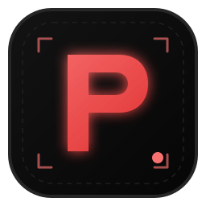

<div align="center">
  
  <h1>OpenProStreet Client</h1>
  <p>The game plugin for OpenProStreet servers, for Need for Speed: ProStreet. Formerly ProStreetRPC.</p>
  <p>
    <a href="https://weexnes.dev/project/OpenProStreet/client#artifacts"></a>
    <a href="#requirements"></a>
    <a href="#build-from-source"></a>
  </p>
</div>

---

## Features

- **Secure login:** Encrypts all traffic to an OpenProStreet server, so the game's password isn't sent in plaintext. Your name and password work on any PC. Older servers still work, without encryption.
- **Race results:** Sends your lap times, track, race mode and position to the server after each race, for records and leaderboards.
- **Quick play:** "Schnelles Spiel" no longer tries EA's closed servers. It logs in to the server and joins a quick play race day by itself. If none is running, the server starts one with a random location and events, with AI opponents. If there's still nothing to join a few seconds after the list shows, the list stays open, with the same race days as LAN play, and you pick one.
- **Event votes:** In a race day's lobby, F1 opens a window with the race day's events. Pick one with the arrow keys or the mouse and call a vote; the game doesn't get the keyboard or mouse while the window is open. Everyone in the room then votes with F1 (yes) or F2 (no). It passes with more than half of the room, the lobby countdown waits for it (20 seconds at most), and the event becomes the next one. Needs server 1.23. The keys are `Key` and `NoKey` under `[Vote]` in the ini, and `Enabled=0` turns it off.
- **Dynamic status:** Displays whether you are in a race day, navigating menus, or in career.
- **Player car display:** Detects the car currently driven by the player and translates internal models to real vehicle names (e.g. "Nissan GT-R (R35)", "Mazda RX-7", "Chevrolet Corvette Z06", "Toyota Supra").
- **Race mode and event type:** Identifies specific race types (e.g. "Grip", "Drift", "1/4 Mile Drag", "Wheelie Competition", "Speed Challenge", "Top Speed Run", "Sector Shootout", "Time Attack", "Grip Class").
- **Detailed stats:** Shows your current career balance and Raceday XP (formatted with commas).
- **Map identification:** Detects the current track/map and translates internal identifiers to human-readable names (e.g. "Nevada Highway", "Chicago Airfield").
- **Dynamic cycle:** Automatically cycles Discord details line between track name, race type, current car, and Raceday XP during gameplay.
- **Car fixes built in:** No tank slapper and no speed limiter on any car, the same changes the NFS-VltEd scripts "Tank Unslapper" and "Speed Limiter Removed" make, without VltEd. See [Car fixes](#car-fixes).
- **Main menu:** The "LAN Play" button reads "OpenProStreet" in every language, the copyright line shows the client version, and the game no longer tries to log in to EA (the "Connecting to EA server..." popup you had to cancel).
- **Account screen:** "Create new LAN account" and "Use existing LAN account" read "Create OpenProStreet account" and "Log in to OpenProStreet account", the title above them reads "OpenProStreet", and the messages around creating an account say OpenProStreet too.
- **Safe memory management:** Validates pointers and handles memory reading safely to prevent game crashes.

## Requirements

This plugin was developed for the **v1.1 (Europe) "Battery 1.1 nocdfix"** executable layout.

- **Compatibility:** the Battery No-CD fix is recommended for exact memory address offset resolution.
- **Packed executables:** not supported, for example the "Vitality" 1.1 No-CD (3.7 MB, MD5 `15082baf8bb09b3298768c9b5c2b946e`). Its code is still compressed when plugins load, so neither this client nor XNFSPS MultiFix can patch it, and settings like the resolution won't stick. The client detects this, shows a message and stays off.
- **Game version:** NFS ProStreet updated to version **1.1**.
- **XNFSPS MultiFix:** required. It also loads plugins from the `scripts` folder.
- **Fusion Fix:** not compatible. Remove it before installing.
- **Disclaimer:** this project does not promote software piracy; ownership of a legitimate copy of the game is expected.

## Install

Pre-compiled release bundles (`OpenProStreetClient_v*.zip`) containing the ASI plugin and `discord_game_sdk.dll` can be
downloaded from **[weexnes.dev/project/OpenProStreet/client](https://weexnes.dev/project/OpenProStreet/client#artifacts)**.

1. Download the latest release from [weexnes.dev Artifacts](https://weexnes.dev/project/OpenProStreet/client#artifacts).
2. Extract the archive contents: place `OpenProStreetClient.asi` and `discord_game_sdk.dll` into your NFS ProStreet `scripts/` directory (`<prostreet-root>/scripts/`).
3. **If you're upgrading from ProStreetRPC, delete `scripts/ProStreetRPC.asi`.** Running both would hook the game twice.
4. Make sure Discord is running and launch NFS ProStreet!

## Usage

Settings live in `scripts/OpenProStreetClient.ini`.

### Your account

Your name and password log you in, from any PC with the plugin. The plugin also keeps a key in `%LOCALAPPDATA%\OpenProStreet\identity.key` for the encrypted login. It's created on its own, and you don't need to copy it to another PC.

To skip typing your name and password, turn on "Log in automatically" in the launcher's settings and enter them there. The launcher saves them under `[Account]` in `scripts/OpenProStreetClient.ini`:

```ini
[Account]
AutoLogin=1
Username=YourName
Password=dpapi:...
```

On Windows the password is encrypted for your Windows user, so other users of the PC can't read it from the file. On Linux it's saved as you typed it. You still press "log in" on the account screen yourself. Instead of opening the screen where you'd type your name and password, the plugin logs in with the saved ones, and you go on to the race days. Nothing is pressed for you. If the saved name or password is wrong, the next press of "log in" opens the usual screen, so you can type them in. Any other failure is tried again on the next press.

### Choosing a server

The plugin goes straight to `weexnes.dev`, without the address screen. To use another server, create `scripts/OpenProStreetClient.ini`:

```ini
[Server]
Address=play.example.com
Port=10104
```

`Address` is a domain or IP address. `Port` is optional. With `Address=` left empty, the game searches your LAN for a server, then asks for an address if it finds none.

### Borderless fullscreen

To run the game in a borderless window that fills your primary monitor, add this to `scripts/OpenProStreetClient.ini`:

```ini
[Display]
Borderless=1
```

The game keeps running when you tab out. Set its resolution to your monitor's for the sharpest picture, because other resolutions are stretched to fit.

### Car fixes

The client changes these values while the game loads `GLOBAL\ATTRIBUTES.BIN`:

- **No tank slapper:** each car's `TANK_SLAPPER_TIMER` is set to 0, so cars don't start weaving at high speed.
- **No speed limiter:** both `SPEED_LIMITER` values on each car are set to 900, so a car's top speed comes from its engine and gearing.
- **No camera vibration:** `Enable` is set to false in every `cameravibration` preset (`default`, `bumperhood`, `close`, `far`, `staging`).

These are the same edits as the NFS-VltEd scripts "Tank Unslapper" and "Speed Limiter Removed" and turning off camera vibration in VltEd, so you don't need VltEd anymore. The file on disk isn't changed. If you already applied those scripts, nothing changes: values that are already set are left alone. Camera vibration only changes your own view. To turn any of them off:

```ini
[Physics]
NoTankSlapper=0
NoSpeedLimiter=0

[Display]
NoCameraVibration=0
```

You can race with or without the speed limiter on the same server. The client tells the server which one your cars have, and records are kept apart for each, so the leaderboards only compare like with like.

The client also sends the server a hash of this file with each race result. The hash is taken with all three fixes made, so it's the same whether you turned a fix off or VltEd already made it. A server can use it to keep results from edited car data off its leaderboard.

### Writing a server's event catalog

Server admins who use the control panel need a list of the game's events, and only the game knows them. Add this to `scripts/OpenProStreetClient.ini`, start the game and open LAN play or Quick Match once:

```ini
[Debug]
DumpEvents=1
```

The plugin writes `%LOCALAPPDATA%\OpenProStreet\event_catalog.json`. Copy it next to the server, then remove the setting.

### Overlay

During a race on an OpenProStreet server, a card in a corner shows where you stand on that track, layout and mode: the server record and its holder, your best and place, the time just ahead of yours to beat, and your live latency to the server. In a room between races, it shows who is in the room, their cars, ready status, latency, and any allowed car restrictions. Hold **Tab** in a race or lobby for a centered live scoreboard with everyone's rank, car, times/scores and ping, press **F3** to hide or show the corner HUD, and press **F4** to open the in-game settings menu (to adjust Overlay, Atmosphere, Camera, and ReShifted settings live and save them back to `OpenProStreetClient.ini`). Real in-game chat messages from players in your room also pop up cleanly as live overlay messages, and after each race a short notification says what it meant: a new personal best or server record with your place, the XP you earned, a new level, or why the result didn't count. It's drawn with Dear ImGui on the game's Direct3D 9 frames, in the style of the website.

```ini
[Overlay]
Enabled=1
Notifications=1
Scoreboard=1        ; 1 enables the centered live scoreboard when holding ScoreboardKey
Ping=1              ; 1 shows server and player latency (ms) in the overlay
Chat=1              ; 1 shows live in-game chat messages from players in your room
Position=TopRight   ; TopLeft, TopRight, BottomLeft or BottomRight
Scale=100           ; percent, 50 to 200
Test=0              ; 1 always shows a small panel bottom left, to check the overlay reaches the screen
LobbyCars=1         ; in a room, outside races, a card with everyone in it and the car they picked
PaceBar=1           ; 1 shows the live pace bar while racing
ToggleKey=F3        ; hotkey to hide or show the corner HUD
ScoreboardKey=Tab   ; hold to show the centered live scoreboard
SettingsKey=F4      ; hotkey to open the in-game settings menu
```

### Day and night

ProStreet only has day lighting on PC. Its own time of day switch loads a pre-lit `_Sunset` copy of each track, which only other platforms have. The plugin changes the light the game hands its shaders every frame instead: the sun, ambient, fog and sky colours and the overall brightness. **F8** switches between the game's own day, a low warm dusk and a dim blue night. Shadows stay where the day's sun baked them, and there are no street lights.

The game also ships 15 skies, `SKY_STYLE_01` to `SKY_STYLE_15`, and each track picks one. Dusk swaps in style 11, a sunset with warm clouds, and night style 15, a starry sky. A sky only changes as a track loads, as the game itself does, so a new look's sky shows from the next race. **F9** steps through the 15 skies the same way, to try them.

```ini
[Atmosphere]
Enabled=1
Start=Day   ; Day, Dusk or Night
Key=F8      ; F1 to F12
SkyKey=F9   ; F1 to F12
Log=0       ; 1 lists every lighting value the game sets, once each, in the detailed log

[Atmosphere.Night]
SkyStyle=15 ; 1 to 15, or 0 for the track's own sky
```

Each look can be tuned, one line per shader parameter. Three or four numbers multiply its x, y, z (and w), one number multiplies them all, and an empty value turns a default off:

```ini
[Atmosphere.Night]
cvWorldSunColour=0.09,0.12,0.24
cvWorldAmbientColour=0.2,0.24,0.38
cvFogColour=0.12,0.14,0.24
FFSKYCOLOR=0.15,0.18,0.3
cfBrightness=0.55
```

The defaults also tint `cvInstanceWorldSunColour`, `cvAmbientColour`, `FogColor` and `cfBloomScale`, and the car's own light: `cmLocalColourMatrix` (a colour per row), `cvLightColour` and `cvSpecularColour`. A rule written `EFFECT:parameter` applies in that effect only, and wins over one for the parameter everywhere. The sky darkens that way: `IDI_SKY_FX:cvVertexPowerBrightness=1,0.07,1,1`, as the sky's shader only uses its y, as brightness. `[Atmosphere.Dusk]` works the same way. With `Log=1`, the detailed log names each parameter, the effect it belongs to and the value the game first sets, and marks the ones a look changes. The game sets nearly all of them with `ID3DXEffect::SetRawValue`.

### Graphics and shaders

The client can sharpen textures at distance with up to 16× anisotropic filtering on linear samplers (off unless you turn it on), and can swap the game's Direct3D 9 shaders at load time without editing `nfs.exe`. Replacement `.cso` shaders live in `scripts/OpenProStreetShaders/` and are named `<anything>-<16-hex-id>.cso`, matched by FNV-1a hash of the game's bytecode:

```ini
[Graphics]
Anisotropy=16 ; off by default; 2 to 16 turns it on, 0 leaves the game's filtering alone
Shaders=1     ; 0 ignores scripts/OpenProStreetShaders
Log=0         ; 1 lists each shader the game creates with its id, once, in the detailed log
```

### Texture packs

TexMod packs unpacked into `scripts/OpenProStreetTextures/<pack>/<8-hex-id>.dds` (for example by OpenProStreet Launcher) are swapped in automatically as textures load, without needing TexMod:

```ini
[Textures]
Enabled=1     ; 0 turns texture packs off
Log=0         ; 1 lists each loaded texture id, once, in the detailed log
```

### Right-stick camera orbit

In non-drag races with Automatic transmission enabled, the direction of the controller's right stick picks where the exterior camera sits around your car: down is the normal view from behind, up shows the car from the front, left shows it from its right side and right from its left side, with everything in between for diagonals. Release the stick and the camera swings back behind the car. This replaces the right-stick manual shift override.

```ini
[Camera]
RightStickOrbit=1    ; off by default, 1 turns it on (and replaces the right-stick manual shift override)
OrbitBlockShift=1    ; 1 disables right-stick manual shift override while active
OrbitDeadzone=30     ; how far the stick must be pushed before the camera moves, in percent (5 to 90)
OrbitSnapTime=50     ; milliseconds to reach a new angle (0 = instant)
OrbitBackTime=250    ; milliseconds to swing back behind the car after release (0 = instant)
OrbitInvertX=0       ; 1 swaps the left and right sides
OrbitInvertY=0       ; 1 swaps front and back (pull the stick back to look back)
```

### ReShifted automatic transmission

**ReShifted** makes the automatic gearbox follow how you drive. With little throttle it shifts up early at low RPM; with a lot of throttle it holds each gear to the shift point the game computed for that car (near the redline). Flooring it kicks down, braking shifts down and holds the gear through the corner. The per-car data comes from the game's own shift tables, so tuning and upgrades are included.

```ini
[Transmission]
ReShifted=1 ; off by default, 1 turns it on

[ReShifted]
Style=2                ; 1 = Classic (throttle only, 1 gear at a time, stock shift speed), 2 = Adaptive
SportMemory=1          ; 1 remembers recent hard driving for a few seconds after lifting (Adaptive only)
CoastDownshift=1       ; 1 shifts down while coasting off the throttle (Adaptive only)
QuickShift=1           ; 1 shortens gear changes when driving hard (Adaptive only)
SkipGears=1            ; 1 lets one kickdown drop several gears at once (Adaptive only)
Indicator=1            ; 1 shows the ECO / SPORT marker in the overlay while racing
ShortShiftFraction=28  ; gentle-driving shift point, % of the way from idle to redline (10 to 55)
SportRedlineSafety=97  ; highest shift point, % of redline (88 to 99)
EcoThrottle=25         ; up to this throttle % the gearbox short-shifts (0 to 80)
SportThrottle=85       ; from this throttle % it holds to the sport shift point (10 to 100)
KickdownAggression=100
QuickShiftTime=60      ; gear change time when driven hard, % of the stock time (30 to 100)
Log=0                  ; 1 prints every shift decision to the console
```

### Display test

A test for working on an overlay, not for playing. Add this to `scripts/OpenProStreetClient.ini`:

```ini
[Debug]
DisplayTest=1
```

Three squares then appear in the top left corner of the game, each drawn a different way:

- **Red:** cleared on the back buffer just before the frame is shown.
- **Green:** cleared on whatever the game is drawing to, at the end of each of its scenes. It may also turn up in reflections or other effects.
- **Blue:** drawn as triangles on the back buffer just before the frame is shown, the way an overlay draws.

Every 10 seconds the console says how many display devices the game made, and for each one how often it presented, its size and mode, and whether anything failed. It also names the file each hooked function is in, which shows whether the game draws through Windows' `d3d9.dll`, DXVK or another overlay. Which squares show, and those lines, say where an overlay has to draw. Remove the setting to play normally.

### Console log

If another plugin opens a console, such as XNFSPS MultiFix with `EnablePrints = 1`, this plugin shows short, coloured lines there. For the detailed log, or to turn colour off, create `scripts/OpenProStreetClient.ini`:

```ini
[Log]
Verbose=1
Colour=0
```

Colour is also off when `NO_COLOR` is set, and the detailed log has no colour.

## Build from source

The Monocypher encryption library, MinHook (BSD licence) and Dear ImGui (MIT licence), for the overlay, are included in `vendor/`.

### Linux cross-compilation (recommended)

```bash
# Install dependencies (MinGW-w64 toolchain, CMake, Make, curl, unzip)
sudo pacman -S mingw-w64-gcc cmake make curl unzip

# Run the automated cross-build script
bash build.sh
```

Output binaries and the release zip are placed in `build/`.

To test the encryption code against a server without the game, build `tests/` and run `secure_proxy`.

### Windows native build (Visual Studio and vcpkg)

```bash
vcpkg install discord-game-sdk:x86-windows
cmake -B build -A Win32 -DCMAKE_TOOLCHAIN_FILE=[path-to-vcpkg]/scripts/buildsystems/vcpkg.cmake
cmake --build build --config Release
```

## License

No license has been chosen yet. Part of the Need for Speed: ProStreet modding ecosystem.
Repository: [code.weexnes.dev/OpenProStreet/client](https://code.weexnes.dev/OpenProStreet/client).
